# Database Design

> Parent: [master-sdd.md](../master-sdd.md) · PostgreSQL 16

## 1. Conventions

| Concern | Decision |
|---------|----------|
| Primary keys | `UUID` default `gen_random_uuid()` (pgcrypto). Non-guessable, safe in URLs, no cross-table collisions |
| Timestamps | `created_at` / `updated_at` `TIMESTAMPTZ NOT NULL DEFAULT now()` on every table; `updated_at` maintained by a shared `set_updated_at()` trigger |
| Soft delete | `deleted_at TIMESTAMPTZ NULL` on entities referenced by history (`users`, `customer_addresses`, `restaurants`, `menu_categories`, `food_items`). Every query filters `deleted_at IS NULL` unless it is an admin/history read |
| Money | `NUMERIC(10,2)` — see [ADR-009](#adr-009-numeric102-for-money) |
| Ratings | `NUMERIC(3,2)` for averages (0.00–5.00), `SMALLINT` for individual 1–5 ratings |
| Enums | Native PostgreSQL `ENUM` types — see [ADR-012](#adr-012-native-postgresql-enums) |
| Naming | `snake_case`, plural tables, `<singular>_id` foreign keys, `idx_<table>_<cols>` indexes, `uq_<table>_<cols>` unique constraints, `chk_<table>_<rule>` checks |
| Text search | `pg_trgm` GIN indexes on `restaurants.name` and `food_items.name` |
| Email | `CITEXT` for case-insensitive uniqueness (BR-A1) |

Required extensions: `pgcrypto`, `citext`, `pg_trgm`.

## 2. Enum types

```sql
CREATE TYPE user_role          AS ENUM ('CUSTOMER','RESTAURANT','DRIVER','ADMIN');
CREATE TYPE user_status        AS ENUM ('ACTIVE','SUSPENDED');
CREATE TYPE restaurant_status  AS ENUM ('PENDING_APPROVAL','ACTIVE','SUSPENDED','REJECTED');
CREATE TYPE driver_status      AS ENUM ('PENDING_APPROVAL','ACTIVE','SUSPENDED');
CREATE TYPE driver_availability AS ENUM ('OFFLINE','AVAILABLE','ON_DELIVERY');
CREATE TYPE vehicle_type       AS ENUM ('BICYCLE','MOTORCYCLE','CAR');
CREATE TYPE cart_status        AS ENUM ('ACTIVE','CONVERTED','ABANDONED');
CREATE TYPE order_status       AS ENUM ('PENDING','CONFIRMED','PREPARING','READY_FOR_PICKUP','OUT_FOR_DELIVERY','DELIVERED','CANCELLED');
CREATE TYPE dispatch_state     AS ENUM ('NOT_REQUIRED','UNASSIGNED','OFFERED','ASSIGNED','COMPLETED');
CREATE TYPE actor_type         AS ENUM ('CUSTOMER','RESTAURANT','DRIVER','ADMIN','SYSTEM');
CREATE TYPE cancellation_reason AS ENUM (
  'CUSTOMER_CHANGED_MIND','CUSTOMER_ORDERED_BY_MISTAKE',
  'RESTAURANT_TOO_BUSY','RESTAURANT_CLOSED','OUT_OF_STOCK',
  'NO_DRIVER_AVAILABLE','UNDELIVERABLE_ADDRESS','ADMIN_INTERVENTION','ACCEPT_TIMEOUT');
CREATE TYPE assignment_status  AS ENUM ('OFFERED','ACCEPTED','DECLINED','EXPIRED','CANCELLED','COMPLETED');
CREATE TYPE payment_method     AS ENUM ('CASH_ON_DELIVERY');
CREATE TYPE review_status      AS ENUM ('PUBLISHED','HIDDEN');
```

`payment_method` is a one-value enum on purpose: the column and the shape exist
so a card gateway is an enum extension rather than an order-history migration.

## 3. Entity relationship diagram

```mermaid
erDiagram
    USERS ||--o{ CUSTOMER_ADDRESSES : "has"
    USERS ||--o| RESTAURANTS : "owns (1:1)"
    USERS ||--o| DRIVER_PROFILES : "has (1:1)"
    USERS ||--o{ REFRESH_TOKENS : "holds"
    USERS ||--o{ CARTS : "owns"
    USERS ||--o{ ORDERS : "places (as customer)"
    USERS ||--o{ ORDERS : "delivers (as driver)"
    USERS ||--o{ REVIEWS : "writes"
    USERS ||--o{ ADMIN_AUDIT_LOGS : "performs (as admin)"
    USERS ||--o{ DELIVERY_ASSIGNMENTS : "receives (as driver)"
    USERS ||--o{ ORDER_STATUS_EVENTS : "triggers"

    RESTAURANTS ||--o{ RESTAURANT_HOURS : "opens on"
    RESTAURANTS ||--o{ MENU_CATEGORIES : "organizes"
    RESTAURANTS ||--o{ FOOD_ITEMS : "sells"
    RESTAURANTS ||--o{ CARTS : "is bound to"
    RESTAURANTS ||--o{ ORDERS : "receives"
    RESTAURANTS ||--o{ REVIEWS : "is rated in"

    MENU_CATEGORIES ||--o{ FOOD_ITEMS : "groups"

    CARTS ||--o{ CART_ITEMS : "contains"
    FOOD_ITEMS ||--o{ CART_ITEMS : "referenced by"
    FOOD_ITEMS ||--o{ ORDER_ITEMS : "snapshotted into"

    ORDERS ||--|{ ORDER_ITEMS : "contains"
    DISCOUNT_CODES ||--o{ ORDER_DISCOUNTS : "redeemed as"
    DISCOUNT_CODES ||--o{ CARTS : "applied to"
    RESTAURANTS |o--o{ DISCOUNT_CODES : "scopes (optional)"
    ORDERS ||--o| ORDER_DISCOUNTS : "snapshots (0..1)"
    ORDERS ||--o{ ORDER_STATUS_EVENTS : "audits"
    ORDERS ||--o{ DELIVERY_ASSIGNMENTS : "is offered via"
    ORDERS ||--o| REVIEWS : "is reviewed by (0..1)"
    CUSTOMER_ADDRESSES ||--o{ ORDERS : "delivered to"

    USERS {
        uuid id PK
        citext email UK
        text password_hash
        text full_name
        text phone
        user_role role
        user_status status
        timestamptz created_at
        timestamptz deleted_at
    }
    RESTAURANTS {
        uuid id PK
        uuid owner_user_id FK "UNIQUE"
        text name
        text slug UK
        text cuisine_type
        numeric delivery_fee
        numeric minimum_order_amount
        int avg_preparation_minutes
        restaurant_status status
        bool is_accepting_orders
        numeric rating_average
        int rating_count
    }
    DRIVER_PROFILES {
        uuid id PK
        uuid user_id FK "UNIQUE"
        vehicle_type vehicle_type
        text vehicle_plate
        driver_status status
        driver_availability availability
        numeric current_latitude
        numeric current_longitude
        numeric rating_average
        int rating_count
    }
    MENU_CATEGORIES {
        uuid id PK
        uuid restaurant_id FK
        text name
        int display_order
        bool is_active
        timestamptz deleted_at
    }
    FOOD_ITEMS {
        uuid id PK
        uuid restaurant_id FK
        uuid category_id FK
        text name
        numeric price
        text image_url
        bool is_available
        timestamptz deleted_at
    }
    CARTS {
        uuid id PK
        uuid customer_user_id FK
        uuid restaurant_id FK "nullable"
        cart_status status
        uuid discount_code_id FK "nullable"
    }
    CART_ITEMS {
        uuid id PK
        uuid cart_id FK
        uuid food_item_id FK
        int quantity
        text notes
    }
    ORDERS {
        uuid id PK
        text order_number UK
        uuid customer_user_id FK
        uuid restaurant_id FK
        uuid driver_user_id FK "nullable"
        uuid delivery_address_id FK "nullable"
        order_status status
        dispatch_state dispatch_state
        numeric subtotal
        numeric delivery_fee
        numeric discount_amount
        numeric tax_amount
        numeric total_amount
        jsonb delivery_address_snapshot
        actor_type cancelled_by
        cancellation_reason cancellation_reason
        timestamptz placed_at
        timestamptz delivered_at
    }
    DISCOUNT_CODES {
        uuid id PK
        citext code UK "unique while not deleted"
        text discount_type "PERCENT or FIXED"
        numeric value
        numeric max_discount_amount "nullable, percent only"
        numeric min_subtotal
        uuid restaurant_id FK "nullable = all"
        timestamptz starts_at
        timestamptz ends_at
        int usage_limit
        int per_customer_limit
        bool is_active
        timestamptz deleted_at
        uuid created_by FK
    }
    ORDER_DISCOUNTS {
        uuid id PK
        uuid order_id FK "unique"
        uuid discount_code_id FK "nullable"
        text code_snapshot
        numeric amount
    }
    ORDER_ITEMS {
        uuid id PK
        uuid order_id FK
        uuid food_item_id FK "nullable, SET NULL"
        text item_name_snapshot
        text item_description_snapshot
        numeric unit_price
        int quantity
        numeric line_total
    }
    ORDER_STATUS_EVENTS {
        uuid id PK
        uuid order_id FK
        order_status from_status
        order_status to_status
        uuid actor_user_id FK "nullable"
        actor_type actor_role
        text reason
        timestamptz created_at
    }
    DELIVERY_ASSIGNMENTS {
        uuid id PK
        uuid order_id FK
        uuid driver_user_id FK
        assignment_status status
        timestamptz offered_at
        timestamptz expires_at
        timestamptz responded_at
    }
    REVIEWS {
        uuid id PK
        uuid order_id FK "UNIQUE"
        uuid customer_user_id FK
        uuid restaurant_id FK
        uuid driver_user_id FK "nullable"
        smallint restaurant_rating
        smallint driver_rating "nullable"
        text comment
        review_status status
    }
    REFRESH_TOKENS {
        uuid id PK
        uuid user_id FK
        text token_hash UK
        uuid family_id
        timestamptz expires_at
        timestamptz revoked_at
    }
    ADMIN_AUDIT_LOGS {
        uuid id PK
        uuid admin_user_id FK
        text action
        text entity_type
        uuid entity_id
        jsonb metadata
    }
    RESTAURANT_HOURS {
        uuid id PK
        uuid restaurant_id FK
        smallint day_of_week
        time opens_at
        time closes_at
        bool is_closed
    }
    NOTIFICATIONS {
        uuid id PK
        uuid user_id FK
        text channel
        text template
        jsonb payload
        timestamptz sent_at
    }
```



## 4. Table detail

### `users`
| Column | Type | Null | Notes |
|--------|------|------|-------|
| `id` | uuid PK | no | |
| `email` | citext | no | `uq_users_email` (unique). BR-A1 |
| `password_hash` | text | no | bcrypt; never selected by public mappers |
| `full_name` | text | no | 2–100 |
| `phone` | text | no | E.164-ish |
| `role` | user_role | no | Immutable after creation (BR-A3, ADR-005) |
| `status` | user_status | no | default `ACTIVE`. BR-A5 |
| `email_verified_at` | timestamptz | yes | Column reserved; verification is a future enhancement |
| `last_login_at` | timestamptz | yes | |
| `created_at` / `updated_at` | timestamptz | no | |
| `deleted_at` | timestamptz | yes | Soft delete. BR-A6 |

Indexes: `uq_users_email`; `idx_users_role_status (role, status) WHERE deleted_at IS NULL`.

### `customer_addresses`
`user_id` → `users(id)` `ON DELETE CASCADE`. Columns: `label`, `line1`,
`line2`, `city`, `district`, `postal_code`, `latitude NUMERIC(9,6)`,
`longitude NUMERIC(9,6)`, `is_default BOOLEAN NOT NULL DEFAULT false`,
`deleted_at`.

- `uq_addresses_one_default`: `UNIQUE (user_id) WHERE is_default AND deleted_at IS NULL` — BR-A7 enforced by the database, not by hope.
- `idx_addresses_user (user_id) WHERE deleted_at IS NULL`.

### `restaurants`
`owner_user_id` → `users(id)` `ON DELETE RESTRICT`, **UNIQUE** (BR-R1). Columns
as in the ERD plus `description`, `phone`, `email`, `logo_url`,
`cover_image_url`, `address_line1`, `city`, `district`, `latitude`,
`longitude`, `approved_at`, `approved_by_user_id`, `rejection_reason`,
`deleted_at`.

- Checks: `chk_restaurants_delivery_fee (delivery_fee >= 0)`, `chk_restaurants_min_order (minimum_order_amount >= 0)`, `chk_restaurants_prep (avg_preparation_minutes BETWEEN 5 AND 180)`, `chk_restaurants_rating (rating_average BETWEEN 0 AND 5)`.
- Indexes: `uq_restaurants_owner`, `uq_restaurants_slug`, `idx_restaurants_browse (status, is_accepting_orders) WHERE deleted_at IS NULL`, `idx_restaurants_cuisine (cuisine_type)`, `idx_restaurants_rating (rating_average DESC)`, `idx_restaurants_name_trgm GIN (name gin_trgm_ops)`.
- `ON DELETE RESTRICT` on the owner is deliberate: a restaurant must never be orphaned, and owners are soft-deleted anyway.

### `restaurant_hours`
`restaurant_id` → `restaurants(id)` `ON DELETE CASCADE`. `day_of_week SMALLINT
CHECK (0..6)` (0 = Sunday), `opens_at TIME`, `closes_at TIME`, `is_closed
BOOLEAN`.

- `uq_hours_restaurant_day UNIQUE (restaurant_id, day_of_week)` — exactly one row per day.
- Check `chk_hours_range`: `is_closed OR (opens_at IS NOT NULL AND closes_at IS NOT NULL AND closes_at > opens_at)`. Overnight hours (22:00–02:00) are **not** supported in v1; a restaurant closing after midnight sets `closes_at = 23:59`. Documented in [assumptions.md](../assumptions.md) A-09.

### `driver_profiles`
`user_id` → `users(id)` `ON DELETE CASCADE`, **UNIQUE**. `status`,
`availability`, `vehicle_type`, `vehicle_plate`, `current_latitude`,
`current_longitude`, `location_updated_at`, `rating_average`, `rating_count`,
`approved_at`, `approved_by_user_id`.

- `idx_drivers_dispatch (status, availability)` — the dispatch hot path (BR-D2).

### `menu_categories`
`restaurant_id` → `restaurants(id)` `ON DELETE CASCADE`. `name`, `description`,
`display_order INT NOT NULL DEFAULT 0`, `is_active BOOLEAN NOT NULL DEFAULT
true`, `deleted_at`.

- `uq_categories_restaurant_name UNIQUE (restaurant_id, lower(name)) WHERE deleted_at IS NULL` — BR-R3, and the partial predicate lets a deleted name be reused.
- `idx_categories_restaurant (restaurant_id, display_order) WHERE deleted_at IS NULL`.

### `food_items`
`restaurant_id` → `restaurants(id)` `ON DELETE CASCADE`; `category_id` →
`menu_categories(id)` `ON DELETE RESTRICT` (BR-R8 — the FK is the backstop
behind the service-level check).

`restaurant_id` is denormalized onto `food_items` even though it is reachable
through `category_id`. It is the single most-filtered column in the system
(menus, search, cart validation, checkout), and carrying it avoids a join on
every one of those paths. A trigger asserts it matches the category's restaurant
so the denormalization cannot drift (BR-R6).

- Checks: `chk_food_items_price (price > 0 AND price <= 9999.99)`.
- Indexes: `uq_food_items_category_name UNIQUE (category_id, lower(name)) WHERE deleted_at IS NULL`; `idx_food_items_restaurant_available (restaurant_id, is_available) WHERE deleted_at IS NULL`; `idx_food_items_name_trgm GIN (name gin_trgm_ops)`.

### `carts` / `cart_items`
`carts.customer_user_id` → `users(id)` `ON DELETE CASCADE`;
`carts.restaurant_id` → `restaurants(id)` `ON DELETE SET NULL`, nullable (an
empty cart is unbound).

- **`uq_carts_one_active UNIQUE (customer_user_id) WHERE status = 'ACTIVE'`** — BR-C1 in the schema. This is the single most important constraint in the cart design: it makes "one active cart" a database invariant rather than a service convention that a race could break.
- `cart_items.cart_id` → `carts(id)` `ON DELETE CASCADE`; `food_item_id` → `food_items(id)` `ON DELETE CASCADE` (deleting a menu item removes it from live carts — carts are ephemeral, unlike orders).
- `uq_cart_items_line UNIQUE (cart_id, food_item_id)` — BR-C6.
- `chk_cart_items_quantity (quantity BETWEEN 1 AND 20)` — BR-C5.
- **No price column** — ADR-008.
- `carts.discount_code_id` → `discount_codes(id)` `ON DELETE SET NULL`, nullable — the code the customer has applied (added by migration 011; [spec-12](../specs/spec-12-discount-codes.md)). It is a preview only: checkout re-validates it.

### `orders`
| Column | Type | Notes |
|--------|------|-------|
| `id` | uuid PK | |
| `order_number` | text UNIQUE | `FF-YYYYMMDD-XXXXXX`, BR-O7 |
| `customer_user_id` | uuid FK → users, `ON DELETE RESTRICT` | History must survive |
| `restaurant_id` | uuid FK → restaurants, `ON DELETE RESTRICT` | |
| `driver_user_id` | uuid FK → users, `ON DELETE SET NULL`, nullable | Set on acceptance |
| `delivery_address_id` | uuid FK → customer_addresses, `ON DELETE SET NULL`, nullable | Convenience link only |
| `delivery_address_snapshot` | jsonb NOT NULL | BR-O6 — the authoritative address |
| `restaurant_name_snapshot` | text NOT NULL | So a renamed restaurant does not rewrite history |
| `status` | order_status NOT NULL DEFAULT `'PENDING'` | |
| `dispatch_state` | dispatch_state NOT NULL DEFAULT `'NOT_REQUIRED'` | FR-7.4 |
| `subtotal`, `delivery_fee`, `tax_amount`, `total_amount` | numeric(10,2) NOT NULL | BR-O3 |
| `discount_amount` | numeric(10,2) NOT NULL DEFAULT 0 | Discount on the items subtotal (BR-DC4); 0 for orders without a code |
| `payment_method` | payment_method NOT NULL DEFAULT `'CASH_ON_DELIVERY'` | |
| `customer_note` | text | ≤500 |
| `cancelled_by` | actor_type, nullable | BR-O8 |
| `cancellation_reason` | cancellation_reason, nullable | |
| `cancellation_note` | text, nullable | |
| `placed_at`, `confirmed_at`, `preparing_at`, `ready_at`, `picked_up_at`, `delivered_at`, `cancelled_at` | timestamptz, nullable | The timeline the tracking UI renders |

- Checks: `chk_orders_totals (total_amount = subtotal - discount_amount + delivery_fee + tax_amount)` — arithmetic enforced by the database, so a service bug cannot persist a wrong total (tax is charged on the discounted subtotal, BR-DC6; the check restates only the sum); `chk_orders_discount (discount_amount >= 0 AND discount_amount <= subtotal)`; `chk_orders_cancel_fields (status <> 'CANCELLED' OR (cancelled_by IS NOT NULL AND cancellation_reason IS NOT NULL))` — BR-O8; `chk_orders_amounts_nonneg`.
- Indexes: `idx_orders_customer (customer_user_id, created_at DESC)`; `idx_orders_restaurant_status (restaurant_id, status, created_at DESC)`; `idx_orders_driver (driver_user_id, status)`; `idx_orders_dispatch (dispatch_state, confirmed_at) WHERE status IN ('CONFIRMED','PREPARING','READY_FOR_PICKUP')`; `idx_orders_pending_timeout (status, placed_at) WHERE status = 'PENDING'`.

### `order_items`
`order_id` → `orders(id)` `ON DELETE CASCADE`; `food_item_id` → `food_items(id)`
**`ON DELETE SET NULL`** (BR-O2). Snapshot columns `item_name_snapshot`,
`item_description_snapshot`, `unit_price`, `quantity`, `line_total`, `notes`.

- Check `chk_order_items_line_total (line_total = unit_price * quantity)`.
- Check `chk_order_items_quantity (quantity BETWEEN 1 AND 20)`.
- `idx_order_items_order (order_id)`.

**This table is where G2 lives.** Nothing in it is read from `food_items` after
creation; the FK exists only so a restaurant can see "which of my current items
sold well", and it is allowed to go null.

### `discount_codes`
Owned by the discounts module ([spec-12](../specs/spec-12-discount-codes.md)).

| Column | Type | Notes |
|--------|------|-------|
| `id` | uuid PK | |
| `code` | citext NOT NULL | Compared case-insensitively; the API stores it upper-case |
| `description` | text, nullable | Admin-facing |
| `discount_type` | text NOT NULL | `PERCENT` \| `FIXED` |
| `value` | numeric(10,2) NOT NULL | A percentage (≤ 100) or an amount |
| `max_discount_amount` | numeric(10,2), nullable | Cap, percent only |
| `min_subtotal` | numeric(10,2) NOT NULL DEFAULT 0 | Judged on the pre-discount subtotal |
| `restaurant_id` | uuid FK → restaurants `ON DELETE CASCADE`, nullable | Null = every restaurant |
| `starts_at`, `ends_at` | timestamptz, nullable | Validity window |
| `usage_limit`, `per_customer_limit` | integer, nullable | Null = unlimited |
| `is_active` | boolean NOT NULL DEFAULT true | Deactivate / reactivate |
| `deleted_at` | timestamptz, nullable | Soft delete — see ADR-013 |
| `created_by` | uuid FK → users `ON DELETE SET NULL` | |

- Checks: `chk_discount_type`, `chk_discount_value (value > 0 AND (discount_type <> 'PERCENT' OR value <= 100))`, `chk_discount_cap` (percent only), `chk_discount_min_subtotal`, `chk_discount_window (starts_at < ends_at)`, `chk_discount_limits (>= 1)`.
- **`uq_discount_codes_code UNIQUE (code) WHERE deleted_at IS NULL`** — BR-DC1: case-insensitive through `citext`, and a deleted code releases its name.
- Usage is not stored: it is counted from `order_discounts` joined to non-cancelled orders, under a `FOR UPDATE` lock on the code row at checkout (BR-DC7, BR-DC9).

### `order_discounts`
`order_id` → `orders(id)` `ON DELETE CASCADE`, unique (one code per order,
BR-DC11); `discount_code_id` → `discount_codes(id)` **`ON DELETE SET NULL`**;
`code_snapshot text`, `amount numeric(10,2) CHECK (amount > 0)`. The snapshot
keeps the order's discount intact when the code is edited or deleted (BR-DC10).
`idx_order_discounts_code (discount_code_id)`.

### `order_status_events`
Append-only audit (FR-6.4). `order_id` `ON DELETE CASCADE`, `from_status`
(nullable for the creation event), `to_status`, `actor_user_id` (nullable for
`SYSTEM`), `actor_role`, `reason`, `note`, `created_at`.
The creation event (`null → PENDING`) names whoever placed the order: the
customer at checkout (`CUSTOMER`), or the admin who placed it on the
customer's behalf (`ADMIN`, FR-9.10).
Index `idx_status_events_order (order_id, created_at)`.

### `delivery_assignments`
`order_id` → `orders(id)` `ON DELETE CASCADE`; `driver_user_id` → `users(id)`
`ON DELETE CASCADE`. `status`, `offered_at`, `expires_at`, `responded_at`,
`decline_reason`, `distance_km NUMERIC(6,2)`.

- **`uq_assignments_driver_active UNIQUE (driver_user_id) WHERE status = 'ACCEPTED'`** — BR-D5.
  An assignment therefore leaves `ACCEPTED` as soon as the order finishes:
  `COMPLETED` on delivery, `CANCELLED` otherwise. Without that terminal move
  the partial index would treat the driver as permanently busy and they could
  never accept another order.
- **`uq_assignments_order_accepted UNIQUE (order_id) WHERE status = 'ACCEPTED'`** — one accepted driver per order.
- `uq_assignments_order_open UNIQUE (order_id) WHERE status = 'OFFERED'` — only one live offer at a time.
- `idx_assignments_expiry (status, expires_at) WHERE status = 'OFFERED'` — the expiry job's index.

### `reviews`
`order_id` → `orders(id)` `ON DELETE CASCADE` **UNIQUE** (BR-V2);
`customer_user_id`, `restaurant_id`, `driver_user_id` (nullable).
`restaurant_rating SMALLINT CHECK (1..5) NOT NULL`, `driver_rating SMALLINT
CHECK (1..5)` nullable, `comment` ≤1000, `status review_status DEFAULT
'PUBLISHED'`, `hidden_by_user_id`, `moderation_reason`, `created_at`,
`updated_at`.

- Check `chk_reviews_driver_rating (driver_rating IS NULL OR driver_user_id IS NOT NULL)` — BR-V4.
- Indexes: `uq_reviews_order`; `idx_reviews_restaurant (restaurant_id, created_at DESC) WHERE status = 'PUBLISHED'`; `idx_reviews_driver (driver_user_id) WHERE status = 'PUBLISHED'`.

### `refresh_tokens`
`user_id` `ON DELETE CASCADE`, `token_hash text UNIQUE NOT NULL` (SHA-256 of the
opaque token — the token itself is never stored), `family_id uuid NOT NULL`,
`expires_at`, `revoked_at`, `replaced_by_id`, `user_agent`, `ip_address`.
Index `idx_refresh_user_active (user_id) WHERE revoked_at IS NULL`.
Family-wide revocation on reuse detection is a single `UPDATE ... WHERE
family_id = $1`.

### `admin_audit_logs`
`admin_user_id` `ON DELETE RESTRICT`, `action text`, `entity_type text`,
`entity_id uuid`, `metadata jsonb`, `ip_address`, `created_at`. Append-only;
no update or delete path exists in code (FR-9.6).
Index `idx_audit_entity (entity_type, entity_id, created_at DESC)`.

### `notifications`
The stub transport's log (see Non-Goals). `user_id`, `channel` (`EMAIL`/`SMS`/
`IN_APP`), `template`, `payload jsonb`, `sent_at`, `read_at`.

## 5. Cardinality summary

| Relationship | Cardinality | Delete behaviour |
|---|---|---|
| users → customer_addresses | 1 : 0..N | CASCADE |
| users → restaurants | 1 : 0..1 | RESTRICT |
| users → driver_profiles | 1 : 0..1 | CASCADE |
| users → carts | 1 : 0..N (≤1 ACTIVE) | CASCADE |
| users → orders (customer) | 1 : 0..N | RESTRICT |
| users → orders (driver) | 1 : 0..N | SET NULL |
| restaurants → restaurant_hours | 1 : 0..7 | CASCADE |
| restaurants → menu_categories | 1 : 0..N | CASCADE |
| menu_categories → food_items | 1 : 0..N | RESTRICT |
| restaurants → orders | 1 : 0..N | RESTRICT |
| carts → cart_items | 1 : 0..N | CASCADE |
| orders → order_items | 1 : 1..N | CASCADE |
| orders → order_status_events | 1 : 1..N | CASCADE |
| orders → delivery_assignments | 1 : 0..N (≤1 ACCEPTED) | CASCADE |
| orders → reviews | 1 : 0..1 | CASCADE |

**Data ownership:** a row belongs to the actor named in its owning FK. Customers
own their addresses, carts and orders-as-customer. Restaurant owners own their
restaurant and everything hanging off it. Drivers own their profile and
assignments. Admins own audit logs. Every repository read for a non-admin role
carries the owner predicate in the `WHERE` clause — ownership is filtered in
SQL, never checked after fetching.

## 6. Migrations & seeding

Knex migrations, one per logical change, named
`YYYYMMDDHHMMSS_<description>.js`, each with a working `down`. Order:

1. extensions + enum types + `set_updated_at()` trigger function
2. `users`, `refresh_tokens`, `customer_addresses`
3. `restaurants`, `restaurant_hours`, `driver_profiles`
4. `menu_categories`, `food_items` (+ restaurant-consistency trigger)
5. `carts`, `cart_items`
6. `orders`, `order_items`, `order_status_events`
7. `delivery_assignments`
8. `reviews`
9. `admin_audit_logs`, `notifications`
10. seed admin user
11. `011_discounts.js`: `discount_codes`, `order_discounts`, `orders.discount_amount` with the rewritten `chk_orders_totals`, `carts.discount_code_id` (existing orders get a discount of 0)

Migrations never contain business logic and are never edited after being applied
to a shared environment — corrections ship as new migrations.

---

## Architecture Decision Records

### ADR-009: `NUMERIC(10,2)` for money

**Decision.** All monetary columns are `NUMERIC(10,2)`; the Node layer handles
them as strings through a `Money` helper built on integer minor units, and
`pg` is configured to parse `NUMERIC` as a string rather than a JS float.

**Rationale.** `0.1 + 0.2 !== 0.3`. A float delivery fee will eventually
produce a total that fails `chk_orders_totals`, and that check is worth keeping.
`NUMERIC(10,2)` caps an order at 99,999,999.99 — far beyond any real order and
small enough to catch a runaway calculation.

**Consequences.** Every arithmetic operation goes through `shared/money.js`
(`add`, `multiply`, `roundTax`), never bare JS operators. Rounding is half-up at
two decimals, applied once to the tax and never to intermediate line totals.

### ADR-012: Native PostgreSQL enums

**Decision.** Status fields use native `ENUM` types rather than `VARCHAR` +
`CHECK` or lookup tables.

**Rationale.** The database rejects a typo'd status at write time, `psql` output
is readable, and the set of order statuses is genuinely closed — it changes only
when the domain changes, which is a migration-worthy event either way.

**Consequences.** Adding a value requires `ALTER TYPE ... ADD VALUE` (cheap, but
not transactional before PG 12 — fine on 16). Removing one requires a type swap.
Both are acceptable for values that change once a year. Enum values are mirrored
in `shared/constants.js` and a test asserts the two lists match, so JS and SQL
cannot drift.

### ADR-013: Soft delete only where history depends on it

**Decision.** `deleted_at` exists on `users`, `customer_addresses`,
`restaurants`, `menu_categories` and `food_items`. Everything else deletes hard
or does not delete at all.

**Rationale.** Blanket soft-deletion poisons every query with a filter that is
easy to forget. Selective soft-deletion puts the cost only where the benefit is
real: these five tables are referenced by orders, and orders must remain
readable forever.

**Consequences.** Repositories for those five tables expose `findActive*` helpers
that apply the predicate by default, so forgetting the filter requires actively
calling the `*IncludingDeleted` variant. Partial unique indexes carry
`WHERE deleted_at IS NULL` so a deleted name can be reused.
